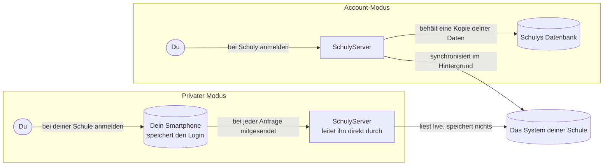

# App-Modi

Auf dieser Seite siehst du, wie sich die beiden App-Modi unterscheiden. Du wählst einen Modus am Gate.
Beide Modi lesen dieselben Schulsysteme aus demselben Backend-Katalog. Sie unterscheiden sich darin, wer
dich anmeldet, wo dein Login aufbewahrt wird und ob Daten auf einem Server liegen. Die App enthält kein
fest codiertes Schulsystem.

| | Account-Modus | Privater Modus |
| --- | --- | --- |
| Authentifizierung bei Schuly | Bearer-Token des Schuly-Kontos | Keine |
| HTTP-Client | `ApiClient` (Auth-Interceptor) | Sauberes `Dio`, nur anonyme Endpunkte |
| Wo die Daten liegen | Serverseitig, in Postgres | Nur auf dem Gerät |
| Rolle des Backends | Speichert Daten und synchronisiert im Hintergrund | Zustandsloser Live-Proxy, speichert nichts |
| Auswahl des Providers | Pro verbundenem Konto | `privateAuthStrategy` im Katalog (`token` oder `scrape`) |

## Was der private Modus auf dem Gerät macht

- Die App schreibt den Schul-Login in den Keystore des Geräts. Der Login verlässt das Gerät nur, wenn die
  App ihn über die anonymen Proxy-Endpunkte des Backends an das Schulsystem sendet.
- Der Verbindungsbildschirm ist generisch. Er zeigt die Login-Felder, die der Katalog für deine Schule
  auflistet, und folgt der `privateAuthStrategy` des Katalogs:
  - `token`: Ein Headless-Login erstellt ein Bearer-Token und eine erneuerbare Session.
  - `scrape`: Die App sendet die Zugangsdaten bei jedem Abruf erneut.
- Wenn deine Schule einen Einmalcode nutzt, speichert die App dessen Seed mit dem Login. Der Bildschirm
  **Authenticator** erzeugt die Codes auf dem Gerät.
- Wenn eine Session abläuft, verbindet sich die App aus dem Keystore neu, ohne dass du dich anmelden musst.
