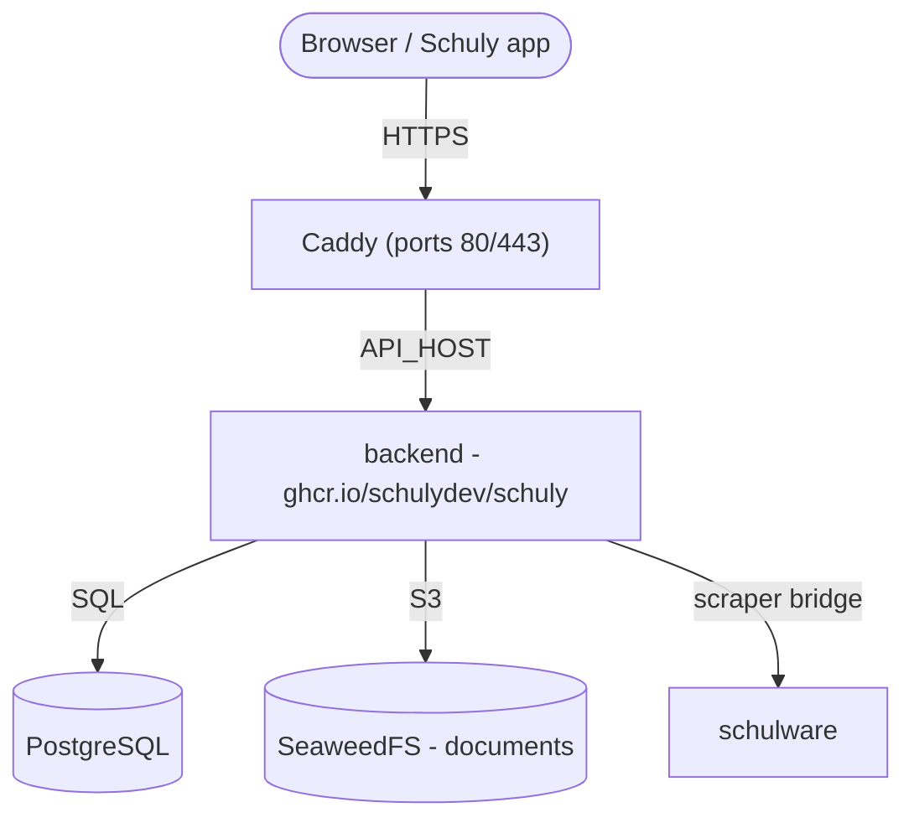

# Self-Hosting

Eine Anleitung von Grund auf, um das Schuly-Backend **und die Dienste, die es
braucht**, auf deinem eigenen Server aufzusetzen - mit den veröffentlichten
GHCR-Images und dem fertigen Stack unter
[`deploy/`](https://github.com/schulydev/SchulyServer/tree/main/deploy). Alles
läuft hinter [Caddy](https://caddyserver.com/) mit automatischem HTTPS.

Für die lokale Entwicklung siehe stattdessen [Entwicklung](development.md). Für
Details zu Image/Release und die vollständige Liste der Einstellungen siehe
[Produktion](production.md) und [Konfiguration](configuration.md).

## Was du betreiben wirst



| Dienst | Image | Exponiert |
|---|---|---|
| `caddy` | `caddy:2` | **80 / 443** - die einzigen öffentlichen Ports |
| `backend` | `ghcr.io/schulydev/schuly` | über Caddy → `https://${API_HOST}` |
| `postgres` | `postgres:18.1` | intern (Datenbank `schuly`) |
| `seaweedfs` | `chrislusf/seaweedfs` | intern - S3-Dokumenten-Storage |
| `schulware` | `ghcr.io/pianonic/schulwareapi` | intern - Schulnetz-Bridge für das Schulware-Plugin |

Die Anmeldung ist ins Backend eingebaut: Es stellt seine eigenen Tokens aus,
validiert sie und speichert die Konten in der Datenbank `schuly`. Es gibt keinen
separaten Identity Provider. Das Backend wendet seine EF-Core-Migrationen beim Start
automatisch an und lädt die in `config/plugins.yml` deklarierten Plugins aus der
Registry herunter (im Image sind keine Plugin-DLLs enthalten).

## Voraussetzungen

- Ein Linux-Server mit **Docker** und dem **Compose-Plugin** (`docker
  compose`).
- Die Ports **80** und **443** offen zum Internet.
- Ein DNS-Eintrag für die API, der auf den Server zeigt (z. B.
  `api.schuly.example`). Caddy braucht ihn beim ersten Start auflösbar, damit
  Let's Encrypt ein Zertifikat ausstellen kann.
- Ein SMTP-Server für Verifizierungs- und Passwort-Reset-Mails.

## 1. Die Deploy-Dateien holen

Das Repo klonen (oder nur den Ordner `deploy/` kopieren) auf den Server und
hineinwechseln:

```sh
git clone https://github.com/schulydev/SchulyServer.git
cd SchulyServer/deploy
```

Alles Folgende läuft aus `deploy/` heraus, das vor jeder Änderung so aussieht:

```
deploy/
├── .env.example
├── Caddyfile
├── compose.staging.yml
├── config/
│   ├── backend.env
│   ├── plugins.yml
│   ├── plugins-config/
│   │   └── Schuly.Plugin.Schulware.yml
│   └── seaweedfs/
│       └── s3-config.json
└── README.md
```

Am Ende dieser Anleitung hast du zusätzlich `.env` (Schritt 3, aus
`.env.example`) und einen Ordner `data/` (automatisch beim ersten `up`
erzeugt, Schritt 5), der alles enthält, was der Stack dauerhaft speichert:

```
deploy/
├── .env                  # ← you create this
├── ...                   #   (unchanged files omitted)
└── data/                 # ← created on first `docker compose up`
    ├── postgres/
    ├── seaweedfs/
    ├── plugins/           # downloaded plugin DLLs
    ├── caddy/              # TLS certificates/state
    └── caddy-config/
```

## 2. DNS auf den Server ausrichten

A/AAAA-Einträge für deinen Hostnamen erstellen und warten, bis sie auf die
öffentliche IP des Servers auflösen. Bis dahin schlägt die Zertifikatsausstellung
fehl.

## 3. Secrets konfigurieren

Die Vorlage kopieren und ausfüllen:

```sh
cp .env.example .env
```

| Variable | Was zu setzen ist |
|---|---|
| `API_HOST` | Öffentlicher Hostname für die API, z. B. `api.schuly.example`. |
| `SCHULY_VERSION` | Tag des Backend-Images. `latest` folgt jedem Release; eine Version wie `1.3.3` fixieren, um selbst zu entscheiden, wann du wechselst. |
| `POSTGRES_USER` | Datenbankbenutzer. |
| `POSTGRES_PASSWORD` | Ein starkes Datenbankpasswort. |
| `LOCAL_LOGIN_SIGNING_KEY` | Schlüssel, der Access-Tokens signiert (erforderlich). Base64 von 32 Bytes - erzeugen mit `openssl rand -base64 32`. Ein neuer Schlüssel meldet alle ab. |
| `TWO_FACTOR_ENCRYPTION_KEY` | Schlüssel, der Zwei-Faktor-Secrets verschlüsselt (erforderlich). Base64 von 32 Bytes - erzeugen mit `openssl rand -base64 32`. Ein neuer Schlüssel macht Zwei-Faktor für jedes Konto unbrauchbar. |
| `ADMIN_EMAIL` | Deine eigene E-Mail-Adresse. Das damit registrierte Konto erhält die Rolle `Administrator`. |
| `S3_ACCESS_KEY` | S3-Access-Key für SeaweedFS. |
| `S3_SECRET_KEY` | S3-Secret-Key für SeaweedFS. |
| `AVATAR_SIGNING_KEY` | HMAC-Schlüssel zum Signieren von Avatar-URLs (erforderlich). Erzeugen mit `openssl rand -hex 32`. |
| `DOCUMENTS_ENCRYPTION_KEY` | Master-Schlüssel, um Schülerdokumente im Ruhezustand zu verschlüsseln (erforderlich). Base64 von 32 Bytes - erzeugen mit `openssl rand -base64 32`. Geht er verloren, sind gespeicherte Dokumente nicht mehr lesbar. |
| `SMTP_HOST`, `SMTP_PORT`, `SMTP_FROM`, `SMTP_USER`, `SMTP_PASSWORD` | Mailserver für E-Mail-Verifizierung und Passwort-Reset. |
| `FIREBASE_SERVICE_ACCOUNT_JSON` | Optional. Base64 eines Firebase-Service-Account-JSON, für Push-Benachrichtigungen - erzeugen mit `base64 -w0 service-account.json`. Ungesetzt lassen, um ohne Push zu laufen. |

> Die S3-Zugangsdaten **müssen mit** `config/seaweedfs/s3-config.json`
> übereinstimmen - aktualisiere sowohl die `.env` als auch diese Datei mit
> denselben Werten, sonst authentifiziert sich der Dokumenten-Storage nicht.

### Kontolöschung

`DELETE /api/auth/me` löscht alles, was das Backend über den Aufrufer speichert:
seine Schulbenutzer und alle Noten, Absenzen, Agenda-Einträge, Semesterzeugnisse und
Dokumente (inklusive der Objekte in S3), danach die Kontozeile selbst. Das
Anmeldekonto (Zugangsdaten, Tokens, Zwei-Faktor) wird im selben Schritt gelöscht.

### Aufbewahrung

Das Backend räumt einmal täglich auf, beginnend fünf Minuten nach dem Start. Es
löscht zwischengespeicherte Schuldaten für Schulbenutzer, deren `LeaveDate` länger
zurückliegt als `Retention__MonthsAfterLeave` (6 Monate), und löscht Konten, die
seit `Retention__MonthsInactive` (12 Monate) keinen authentifizierten Request
gemacht haben. Beide Schwellenwerte und der Schalter `Retention__Enabled` liegen in
[`config/backend.env`](https://github.com/schulydev/SchulyServer/blob/main/deploy/config/backend.env).

Das Aufräumen löscht nur Schuly-Daten, keine Anmeldekonten. Wessen
zwischengespeicherte Daten abgelaufen sind, kann sich also wieder anmelden und neu
synchronisieren.

### Wo die restlichen Einstellungen liegen

`.env` enthält, was sich pro Deployment ändert. Die eigenen Einstellungen des
Backends liegen neben den übrigen Konfigurationsdateien und lesen `${...}`-Werte
direkt aus `.env`:

| Datei | Enthält |
|---|---|
| [`config/backend.env`](https://github.com/schulydev/SchulyServer/blob/main/deploy/config/backend.env) | Backend-Einstellungen - Datenbankverbindung, Anmeldung, SMTP, S3, Plugin-Pfade. |

Normalerweise fasst du sie nicht an; sie existiert, damit `compose.staging.yml`
lesbar bleibt als Abbild des Stacks statt als Wand aus Umgebungsvariablen.

## 4. (Optional) Die Plugins durchsehen

`config/plugins.yml` listet die Plugins, die das Backend beim Start lädt
(standardmässig das Schulware-Plugin), und `config/plugins-config/` enthält
die Konfiguration jedes Plugins. Jedes Plugin **liefert zudem seinen eigenen
Eintrag im School-System-Katalog** - das System, das die App in ihrer Auswahl
zeigt (Schulware liefert `schulnetz`, OdaOrg `odaorg`) - daher fügt die
Installation eines Plugins dessen System automatisch hinzu, ohne
Katalog-Konfiguration. Die Standardwerte funktionieren von Haus aus; passe sie
nur bei Bedarf an.

## 5. Den Stack starten

```sh
docker compose -f compose.staging.yml up -d
docker compose -f compose.staging.yml logs -f backend
```

Beim ersten Start: Postgres legt die Datenbank `schuly` an, das Backend wendet
seine Migrationen an und spielt den School-Systems-Katalog aus den geladenen
Plugins ein, und Caddy bezieht ein TLS-Zertifikat für den Hostnamen.

## 6. End-to-End verifizieren

- `https://${API_HOST}/api/app/school-systems` → der anonyme Katalog-Endpunkt,
  der zeigt, dass die API läuft (`/api/app` ist die einzige nicht
  authentifizierte Route).
- `https://${API_HOST}/api/app` → die App-Konfiguration (ebenfalls anonym);
  ihr Feld `version` zeigt die laufende Backend-Version - praktisch, um ein
  Deployment oder Upgrade zu bestätigen.
- `https://${API_HOST}/api/plugins` → geladene Plugins (erfordert ein Login
  mit der Rolle `Administrator`). Zur Laufzeit verwaltbar mit `POST
  /api/plugins/install` und `DELETE /api/plugins/{name}`.
- Die Schuly-App auf `https://${API_HOST}` richten. Sie meldet sich über die
  `/auth`-Endpunkte des Backends an.

## 7. Deinen ersten Login erstellen

Öffne die Web-App unter `https://${API_HOST}` und registriere dich mit der Adresse,
die du in `ADMIN_EMAIL` eingetragen hast, oder rufe direkt
`POST https://${API_HOST}/auth/register` auf. Bestätige die Adresse über den Link in
der Verifizierungs-Mail. Dieses Konto erhält die Rolle `Administrator`, die du
brauchst, um Plugins über die API zu verwalten. Weitere Administratoren kommen als
`Auth__Administrators__1`, `Auth__Administrators__2` und so weiter in
`config/backend.env`.

Alle anderen registrieren sich auf die gleiche Weise, über die Web-App oder die
Schuly-App. Sie erhalten keine Rolle.

## 8. Für den Produktivbetrieb härten

- Jedes Secret in `.env` rotieren, das noch seinen Beispielwert hat. Tu das, bevor
  sich die ersten Benutzer registrieren: Wird `LOCAL_LOGIN_SIGNING_KEY` oder
  `TWO_FACTOR_ENCRYPTION_KEY` später geändert, werden alle abgemeldet oder
  Zwei-Faktor wird unbrauchbar.
- Die Management-/internen Dienste unexponiert halten - nur Caddy sollte
  Ports veröffentlichen.

## Ohne öffentliche Domain betreiben (LAN / lokales Testen)

Alles Vorherige geht von einer echten Domain mit DNS aus, das du kontrollierst,
damit Caddy ein Let's-Encrypt-Zertifikat beziehen kann. Wenn du den Stack nur
in deinem eigenen Netzwerk betreiben willst - gegen ein Handy über WLAN testen,
keine Domain, kein TLS - ändern sich ein paar Dinge.

Die App (Handy, Browser, Emulator) braucht eine stabile Adresse für das Backend.
Zwei Wege dazu ohne echte Domain:

- **Die LAN-IP deines Rechners, direkt verwendet** - `API_HOST=192.168.1.42`, gar
  kein Hostname. Am einfachsten, und von einem Handy im gleichen WLAN erreichbar.
  Nachteil: bricht, wenn sich die IP ändert (neuer DHCP-Lease), und ist nur aus
  diesem Netzwerk erreichbar.
- **Ein Wildcard-DNS-Hostname, der auf deine LAN-IP zeigt**, z. B.
  `<ip>.nip.io` oder `<ip>.sslip.io` - diese lösen öffentlich direkt auf die
  im Namen codierte IP auf. Angenehmer als eine rohe IP, aber **viele
  Consumer-Router blockieren das**: DNS-Rebind-Schutz (standardmässig aktiv
  bei den meisten FritzBox/AVM-Routern, unter anderem) verweigert die
  Auflösung eines öffentlichen Hostnamens, der auf eine private Adresse zeigt,
  sodass der Name für niemanden in diesem Netzwerk auflöst. Wenn Lookups
  rätselhaft ohne brauchbare Fehlermeldung fehlschlagen, ist fast immer das
  der Grund - dann auf die rohe IP zurückfallen.

Ohne Hostnamen kann Caddy kein Zertifikat beziehen. Es liefert deshalb stattdessen
reines HTTP auf einem festen Port aus.

### Durchgerechnetes Beispiel

Angenommen, die LAN-IP deines Rechners ist `192.168.1.42`. An der Struktur des
Ordners `deploy/` aus Schritt 1 ändert sich nichts - du bearbeitest drei der
bestehenden Dateien an Ort und Stelle, mehr nicht:

```
deploy/
├── .env                  ← create from .env.example; API_HOST = the LAN IP
├── Caddyfile              ← edit: plain HTTP, explicit port
├── compose.staging.yml    ← edit: caddy service ports
├── config/
│   ├── backend.env        ← edit: http mail links
│   ├── plugins.yml         (unchanged)
│   ├── plugins-config/
│   │   └── Schuly.Plugin.Schulware.yml   (unchanged)
│   └── seaweedfs/
│       └── s3-config.json                (unchanged)
└── data/                  (created on first `up`, same as the domain case)
```

**`.env`** - gleiche Vorlage wie in Schritt 3, nur den Hostnamen auf die rohe IP
setzen:

```sh
API_HOST=192.168.1.42
SCHULY_VERSION=latest
POSTGRES_USER=schuly
POSTGRES_PASSWORD=change-me-postgres
LOCAL_LOGIN_SIGNING_KEY=<openssl rand -base64 32>
TWO_FACTOR_ENCRYPTION_KEY=<openssl rand -base64 32>
ADMIN_EMAIL=you@example.com
S3_ACCESS_KEY=schuly-access
S3_SECRET_KEY=change-me-s3-secret
AVATAR_SIGNING_KEY=change-me-avatar-signing-key
DOCUMENTS_ENCRYPTION_KEY=change-me-documents-encryption-key
```

Behalte die `SMTP_*`-Werte, oder richte sie auf einen SMTP-Catcher in deinem
Netzwerk, damit die Verifizierungs-Mails irgendwo ankommen.

**`Caddyfile`** - die ganze Datei ersetzen (die domainbasierte Version bezieht ein
TLS-Zertifikat; diese hier proxyt nur reines HTTP auf einem Port):

```
http://{$API_HOST}:8080 {
	reverse_proxy backend:8080
}
```

**`compose.staging.yml`** - im `caddy`-Dienst die `ports:`-Liste austauschen
(`443:443` weglassen, es gibt kein Zertifikat auszuliefern):

```yaml
  caddy:
    image: caddy:2
    restart: unless-stopped
    ports:
      - "8080:8080"
    environment:
      API_HOST: ${API_HOST}
    volumes:
      - ./Caddyfile:/etc/caddy/Caddyfile:ro
      - ./data/caddy:/data
      - ./data/caddy-config:/config
    depends_on:
      - backend
```

**`config/backend.env`** - die Mail-Links müssen auf die reine HTTP-Adresse zeigen:

```
Email__Smtp__PasswordResetLinkTemplate=http://${API_HOST}:8080/reset-password?token={token}
Email__Smtp__EmailVerificationLinkTemplate=http://${API_HOST}:8080/verify-email?token={token}
```

Dann genau wie in Schritt 5 starten:

```sh
docker compose -f compose.staging.yml up -d
docker compose -f compose.staging.yml logs -f backend
```

Und mit denselben Prüfungen wie in Schritt 6 verifizieren, nur mit `http://`
und einem Port statt `https://`:

```sh
curl http://192.168.1.42:8080/api/app/school-systems       # anonymous catalog
```

Alles Übrige - DNS-unabhängige Schritte wie Plugin-Loading und der
Login-Walkthrough oben - funktioniert genau gleich. Noch etwas Wissenswertes: Die
Windows-Firewall kann beim ersten Mal ein Handy im gleichen WLAN stillschweigend
davon abhalten, diese Ports zu erreichen - erlaube Docker Desktop im **privaten
Netzwerk**, falls danach gefragt wird, oder füge selbst eine eingehende Regel für
die Ports hinzu.

## Betrieb

- **Persistenz** - der gesamte Zustand ist **unter `./data` in
  Host-Ordner gemountet** (keine Named Volumes): `data/postgres`,
  `data/seaweedfs`, `data/plugins`, `data/caddy*`. Das ist das empfohlene
  Setup - deine Daten bleiben auf dem Host sichtbar und lassen sich einfach
  sichern. Die Ordner werden beim ersten `up` erstellt, und ein
  One-Shot-Dienst `init-perms` macht `data/plugins` automatisch für den
  Benutzer des Backends beschreibbar, sodass es beim ersten Lauf einfach
  funktioniert. Zum Zurücksetzen den Stack stoppen und `./data` löschen.
- **Upgrades** - `SCHULY_VERSION` in `.env` auf eine fixe Version statt `latest`
  setzen, damit sich ein Deployment exakt wiederholt und du selbst entscheidest,
  wann du wechselst. Die Version ändern, dann `up -d` zum Vorwärtsrollen.
  Migrationen laufen automatisch auf dem neuen Container; vor grösseren Sprüngen
  `data/postgres` sichern.
- **Umstieg von Keycloak** - ältere Deployments betrieben einen separaten
  Keycloak-Container. Passwörter lassen sich nicht aus Keycloak übernehmen, daher
  registrieren sich bestehende Benutzer neu (oder setzen ihr Passwort zurück). Die
  neuen Anmelde-Einstellungen in `.env` ergänzen (Schritt 3), die Variablen
  `AUTH_HOST`, `KEYCLOAK_VERSION` und `KC_*` entfernen und die neuen Dateien
  `compose.staging.yml`, `Caddyfile` und `config/` aus dem Repo übernehmen.
- **Plugin-Änderungen**, die über die API vorgenommen werden, werden in
  `config/plugins.yml` zurückgeschrieben.

## Referenz: das vollständige `compose.staging.yml`

Der Vollständigkeit halber der komplette Stack, den diese Anleitung betreibt
(dieselbe Datei liegt im `deploy/`-Ordner des Repos). Der gesamte Zustand ist
unter `./data` gemountet - keine Named Volumes - und ein One-Shot-Dienst
`init-perms` macht den Plugins-Ordner beim ersten Start für das Backend
beschreibbar, sodass ein einfaches `docker compose up` funktioniert.

```yaml
services:
  # One-shot: make the bind-mounted plugins folder writable by the backend's
  # non-root user (uid 1654) before it starts, so a plain `up` works on the very
  # first run with no manual chown. Runs once and exits.
  init-perms:
    image: busybox:1.37
    command: sh -c "mkdir -p /data/plugins && chown -R 1654:1654 /data/plugins"
    volumes:
      - ./data:/data
    restart: "no"

  postgres:
    image: postgres:18.1
    restart: unless-stopped
    environment:
      POSTGRES_USER: ${POSTGRES_USER}
      POSTGRES_PASSWORD: ${POSTGRES_PASSWORD}
      POSTGRES_DB: schuly
    volumes:
      # postgres:18 stores data in a versioned subdir, so the data mounts at
      # /var/lib/postgresql (not /var/lib/postgresql/data, which it now rejects).
      - ./data/postgres:/var/lib/postgresql
    healthcheck:
      # -h 127.0.0.1 forces a TCP check. While the entrypoint runs the init
      # scripts it serves on the Unix socket only, so a socket-based check would
      # report healthy mid-init and let dependents connect to a server that is
      # about to restart.
      test: ["CMD-SHELL", "pg_isready -U ${POSTGRES_USER} -d schuly -h 127.0.0.1"]
      interval: 10s
      timeout: 5s
      retries: 10

  seaweedfs:
    image: chrislusf/seaweedfs:latest
    restart: unless-stopped
    command: >
      server -dir=/data
      -s3 -s3.config=/etc/seaweedfs/s3-config.json -s3.port=8333
      -master.volumeSizeLimitMB=1024
    volumes:
      - ./data/seaweedfs:/data
      - ./config/seaweedfs/s3-config.json:/etc/seaweedfs/s3-config.json:ro

  schulware:
    image: ghcr.io/pianonic/schulwareapi:latest
    restart: unless-stopped
    init: true        # reap zombie processes
    ipc: host         # shared memory headroom for the scraper
    environment:
      # Schulnetz client id + PWA host are baked into the SchulwareAPI image as
      # defaults, so no Schulnetz config is needed here.
      PYTHONUNBUFFERED: "1"

  backend:
    image: ghcr.io/schulydev/schuly:${SCHULY_VERSION:-latest}
    restart: unless-stopped
    env_file: [./config/backend.env]
    volumes:
      - ./data/plugins:/app/plugins                        # downloaded plugin DLLs (host folder)
      - ./config/plugins.yml:/app/plugins.yml              # desired plugin set (writable: endpoints rewrite it)
      - ./config/plugins-config:/app/plugins-config:ro     # per-plugin config
    depends_on:
      postgres:
        condition: service_healthy
      init-perms:
        condition: service_completed_successfully

  caddy:
    image: caddy:2
    restart: unless-stopped
    ports:
      - "80:80"
      - "443:443"
    environment:
      API_HOST: ${API_HOST}
    volumes:
      - ./Caddyfile:/etc/caddy/Caddyfile:ro
      - ./data/caddy:/data
      - ./data/caddy-config:/config
    depends_on:
      - backend
```
