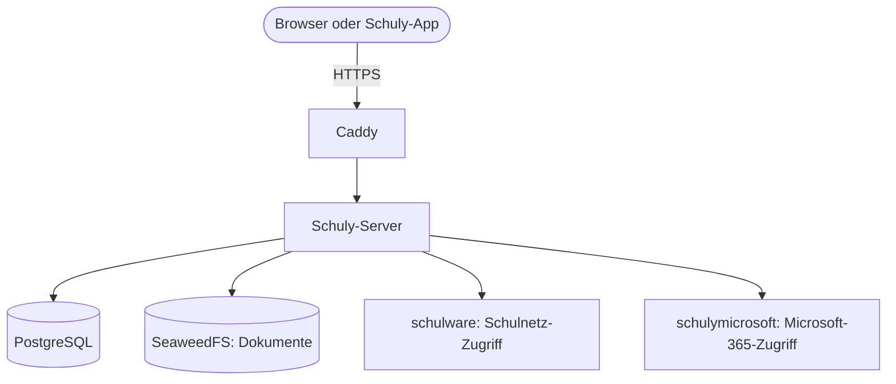

# Schuly selbst hosten

Betreibe deinen eigenen Schuly-Server mit Docker. Am Ende nutzen die Schuly-App und die Web-App deinen Server mit
automatischem HTTPS.

Testest du in deinem Heimnetzwerk, ohne Domain? Nutze [Ohne Domain betreiben](self-hosting-lan.md).

## Was du brauchst

- Einen Linux-Server mit Docker und dem Docker-Compose-Plugin
- Die Ports 80 und 443 offen zum Internet
- Einen Domainnamen für den Server, zum Beispiel `api.schuly.example`
- Einen SMTP-Server, damit Schuly Mails zur Verifizierung und zum Zurücksetzen des Passworts senden kann

## Was auf deinem Server läuft



Nur Caddy ist aus dem Internet erreichbar. Schuly hat eine eigene Anmeldung. Du brauchst also keinen separaten Identity
Provider.

## 1. Domain auf den Server zeigen lassen

Erstelle einen A- oder AAAA-Eintrag für deine Domain und warte, bis er auf deinen Server auflöst. Vorher kann Caddy kein
Zertifikat beziehen.

## 2. Deploy-Dateien holen

```sh
curl -fsSL https://github.com/schulydev/SchulyServer/archive/refs/heads/main.tar.gz | tar -xz --strip-components=1 SchulyServer-main/deploy
cd deploy
cp .env.example .env
```

Führe alle Befehle auf dieser Seite im Ordner `deploy` aus.

## 3. `.env` ausfüllen

Ersetze jeden `change-me`-Wert vor dem ersten Start.

| Variable | Wert |
|---|---|
| `API_HOST` | Deine Domain, zum Beispiel `api.schuly.example` |
| `SCHULY_VERSION` | Eine feste Version aus den [Releases](https://github.com/schulydev/SchulyServer/releases), damit du entscheidest, wann du aktualisierst. `latest` folgt jedem Release. |
| `POSTGRES_USER`, `POSTGRES_PASSWORD` | Ein Datenbank-User und ein starkes Passwort |
| `LOCAL_LOGIN_SIGNING_KEY` | Ausgabe von `openssl rand -base64 32` |
| `TWO_FACTOR_ENCRYPTION_KEY` | Ausgabe von `openssl rand -base64 32` |
| `DOCUMENTS_ENCRYPTION_KEY` | Ausgabe von `openssl rand -base64 32` |
| `VAULT_MASTER_KEY` | Ausgabe von `openssl rand -base64 32` |
| `AVATAR_SIGNING_KEY` | Ausgabe von `openssl rand -hex 32` |
| `S3_ACCESS_KEY`, `S3_SECRET_KEY` | Ein Access Key und ein starkes Secret |
| `SMTP_HOST`, `SMTP_PORT`, `SMTP_FROM`, `SMTP_USER`, `SMTP_PASSWORD` | Dein Mailserver |

Setze dann dieselben S3-Werte in `config/seaweedfs/s3-config.json`. Wenn sie sich unterscheiden, schlägt der
Dokumenten-Storage fehl.

::: warning Sichere `.env` und behalte die Schlüssel
Einen Schlüssel später zu ändern, hat dauerhafte Folgen:

- `LOCAL_LOGIN_SIGNING_KEY`: Alle werden abgemeldet.
- `TWO_FACTOR_ENCRYPTION_KEY`: Zwei-Faktor funktioniert für kein Konto mehr.
- `DOCUMENTS_ENCRYPTION_KEY`: Gespeicherte Dokumente werden unlesbar.
- `VAULT_MASTER_KEY`: Alle müssen ihre Schule neu verbinden.
:::

## 4. Schuly starten

```sh
docker compose -f compose.staging.yml up -d
docker compose -f compose.staging.yml logs -f backend
```

Beim ersten Start richtet Schuly seine Datenbank ein und lädt seine Plugins herunter, und Caddy bezieht ein Zertifikat.

## 5. Prüfen, ob es funktioniert

Öffne `https://<your domain>/api/app/school-systems`. Du solltest eine Liste von Schulsystemen sehen.

## 6. Konto erstellen

Öffne `https://<your domain>` und registriere dich. Jedes Konto ist gleichgestellt und sieht nur seine eigenen Daten. Es gibt
keine Admin-Rolle.

## 7. App verbinden

Wähle in der Schuly-App auf dem Server-Bildschirm **Self-hosted** und gib `https://<your domain>` als **Backend URL** ein.

## Optionale Funktionen

| Funktion | So schaltest du sie ein |
|---|---|
| Push-Benachrichtigungen | Setze `FIREBASE_SERVICE_ACCOUNT_JSON` in `.env`. Siehe [Konfiguration](configuration.md#push-notifications-firebase). |
| Microsoft-Passwort-Anmeldung in der Web-App | Setze `MICROSOFT_SERVICE_KEY` in `.env` auf die Ausgabe von `openssl rand -hex 32`. |
| Single Sign-on | Siehe [Konfiguration](configuration.md#single-sign-on-oidc-providers). |
| Helply, der KI-Assistent | Füge `Helply__BaseUrl` und `Helply__ApiKey` zu `config/backend.env` hinzu. Siehe [Konfiguration](configuration.md#helply). |
| Code-Workspace von Helply | Siehe das [Deploy-README](https://github.com/schulydev/SchulyServer/blob/main/deploy/README.md). |

Wie du wählst, welche Schulsysteme dein Server anbietet, steht unter [Plugin-Verwaltung](../plugin-management.md).

## Nächste Schritte

- [Server betreiben und aktualisieren](operations.md)
- [Alle Einstellungen](configuration.md)
