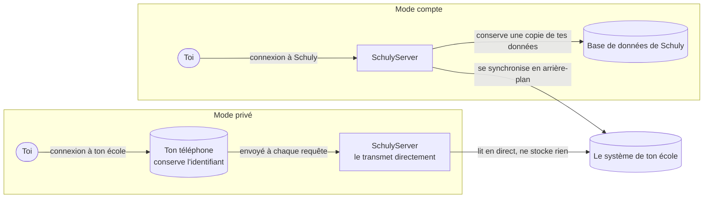

# Modes de l'application

Utilise cette page pour voir en quoi les deux modes de l'application diffèrent. Tu choisis un mode à
l'écran d'entrée. Les deux modes lisent les mêmes systèmes scolaires depuis le même catalogue du backend.
Ils diffèrent sur qui te connecte, où ton identifiant est conservé et si des données restent sur un
serveur. L'application ne code en dur aucun système scolaire.

| | Mode compte | Mode privé |
| --- | --- | --- |
| Authentification auprès de Schuly | Jeton bearer du compte Schuly | Aucune |
| Client HTTP | `ApiClient` (intercepteur d'authentification) | `Dio` vierge, points d'entrée anonymes uniquement |
| Où se trouvent les données | Côté serveur, dans Postgres | Sur l'appareil uniquement |
| Rôle du backend | Stocke les données et synchronise en arrière-plan | Proxy en direct sans état, ne stocke rien |
| Choix du fournisseur | Par compte connecté | `privateAuthStrategy` du catalogue (`token` ou `scrape`) |

## Ce que le mode privé fait sur l'appareil

- L'application écrit l'identifiant de l'école dans le trousseau de l'appareil. L'identifiant ne quitte
  l'appareil que quand l'application l'envoie au système scolaire par les points d'entrée proxy anonymes
  du backend.
- L'écran de connexion est générique. Il affiche les champs de connexion que le catalogue liste pour ton
  école et suit le `privateAuthStrategy` du catalogue :
  - `token` : une connexion sans interface crée un jeton bearer et une session renouvelable.
  - `scrape` : l'application renvoie les identifiants à chaque récupération.
- Si ton école utilise un code à usage unique, l'application stocke sa graine avec l'identifiant. L'écran
  **Authenticator** génère les codes sur l'appareil.
- Quand une session expire, l'application se reconnecte depuis le trousseau sans te demander de te
  connecter.
