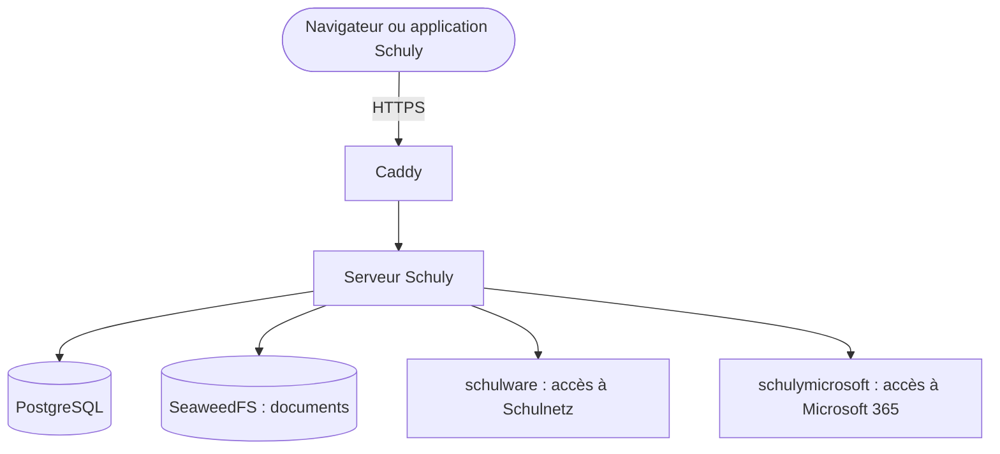

# Auto-héberger Schuly

Fais tourner ton propre serveur Schuly avec Docker. À la fin, l'application Schuly et l'application web utilisent
ton serveur avec HTTPS automatique.

Tu fais des tests sur ton réseau domestique, sans domaine ? Utilise
[Faire tourner Schuly sans domaine](self-hosting-lan.md).

## Ce qu'il te faut

- Un serveur Linux avec Docker et le plugin Docker Compose
- Les ports 80 et 443 ouverts vers Internet
- Un nom de domaine pour le serveur, comme `api.schuly.example`
- Un serveur SMTP, pour que Schuly puisse envoyer les mails de vérification et de réinitialisation du mot de passe

## Ce qui tourne sur ton serveur



Seul Caddy est accessible depuis Internet. Schuly a sa propre connexion, donc tu n'as pas besoin d'un fournisseur
d'identité séparé.

## 1. Pointer ton domaine vers le serveur

Crée un enregistrement A ou AAAA pour ton domaine et attends qu'il pointe vers ton serveur. Caddy ne peut pas
obtenir de certificat avant cela.

## 2. Récupérer les fichiers de déploiement

```sh
curl -fsSL https://github.com/schulydev/SchulyServer/archive/refs/heads/main.tar.gz | tar -xz --strip-components=1 SchulyServer-main/deploy
cd deploy
cp .env.example .env
```

Exécute toutes les commandes de cette page depuis le dossier `deploy`.

## 3. Remplir `.env`

Remplace chaque valeur `change-me` avant le premier démarrage.

| Variable | Valeur |
|---|---|
| `API_HOST` | Ton domaine, comme `api.schuly.example` |
| `SCHULY_VERSION` | Une version fixe des [releases](https://github.com/schulydev/SchulyServer/releases), pour que tu décides quand mettre à jour. `latest` suit chaque release. |
| `POSTGRES_USER`, `POSTGRES_PASSWORD` | Un utilisateur de base de données et un mot de passe fort |
| `LOCAL_LOGIN_SIGNING_KEY` | Sortie de `openssl rand -base64 32` |
| `TWO_FACTOR_ENCRYPTION_KEY` | Sortie de `openssl rand -base64 32` |
| `DOCUMENTS_ENCRYPTION_KEY` | Sortie de `openssl rand -base64 32` |
| `VAULT_MASTER_KEY` | Sortie de `openssl rand -base64 32` |
| `AVATAR_SIGNING_KEY` | Sortie de `openssl rand -hex 32` |
| `S3_ACCESS_KEY`, `S3_SECRET_KEY` | Une clé d'accès et un secret fort |
| `SMTP_HOST`, `SMTP_PORT`, `SMTP_FROM`, `SMTP_USER`, `SMTP_PASSWORD` | Ton serveur de mail |

Définis ensuite les mêmes valeurs S3 dans `config/seaweedfs/s3-config.json`. Si elles diffèrent, le stockage de
documents échoue.

::: warning Sauvegarde `.env` et garde les clés
Changer une clé plus tard a des effets durables :

- `LOCAL_LOGIN_SIGNING_KEY` : tout le monde est déconnecté.
- `TWO_FACTOR_ENCRYPTION_KEY` : la double authentification cesse de fonctionner pour tous les comptes.
- `DOCUMENTS_ENCRYPTION_KEY` : les documents stockés deviennent illisibles.
- `VAULT_MASTER_KEY` : tout le monde doit reconnecter son école.
:::

## 4. Démarrer Schuly

```sh
docker compose -f compose.staging.yml up -d
docker compose -f compose.staging.yml logs -f backend
```

Au premier démarrage, Schuly configure sa base de données et télécharge ses plugins, et Caddy obtient un certificat.

## 5. Vérifier que ça marche

Ouvre `https://<your domain>/api/app/school-systems`. Tu dois voir une liste de systèmes scolaires.

## 6. Créer ton compte

Ouvre `https://<your domain>` et inscris-toi. Tous les comptes sont égaux et chacun ne voit que ses propres données.
Il n'y a pas de rôle d'administrateur.

## 7. Connecter l'application

Dans l'application Schuly, choisis **Self-hosted** sur l'écran du serveur et saisis `https://<your domain>` comme
**Backend URL**.

## Fonctions optionnelles

| Fonction | Comment l'activer |
|---|---|
| Notifications push | Définis `FIREBASE_SERVICE_ACCOUNT_JSON` dans `.env`. Voir [Configuration](configuration.md#push-notifications-firebase). |
| Connexion Microsoft par mot de passe dans l'application web | Définis `MICROSOFT_SERVICE_KEY` dans `.env` avec la sortie de `openssl rand -hex 32`. |
| Authentification unique | Voir [Configuration](configuration.md#single-sign-on-oidc-providers). |
| Helply, l'assistant IA | Ajoute `Helply__BaseUrl` et `Helply__ApiKey` à `config/backend.env`. Voir [Configuration](configuration.md#helply). |
| Le workspace de code de Helply | Voir le [README de déploiement](https://github.com/schulydev/SchulyServer/blob/main/deploy/README.md). |

Pour choisir les systèmes scolaires que ton serveur propose, voir [Gestion des plugins](../plugin-management.md).

## Étapes suivantes

- [Faire tourner et mettre à jour ton serveur](operations.md)
- [Tous les paramètres](configuration.md)
