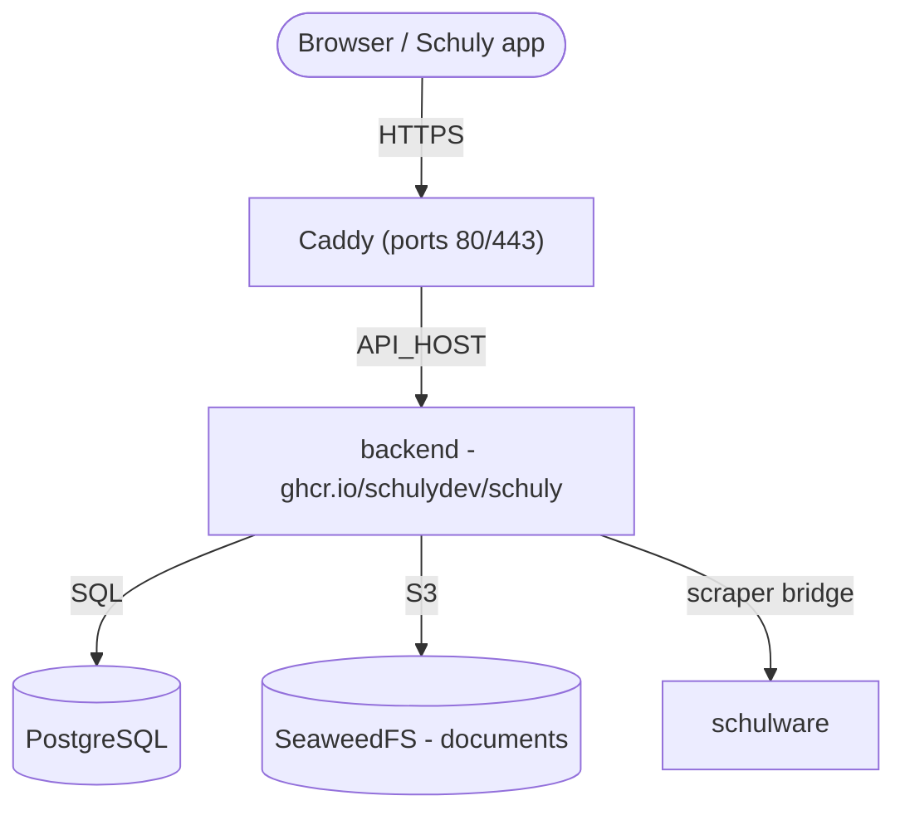

# Auto-hébergement

Un guide pas à pas partant de zéro pour mettre en place le backend Schuly **et les
services dont il a besoin** sur ton propre serveur, en utilisant les images GHCR
publiées et la pile prête à l'emploi sous
[`deploy/`](https://github.com/schulydev/SchulyServer/tree/main/deploy). Tout
s'exécute derrière [Caddy](https://caddyserver.com/) avec HTTPS automatique.

Pour le développement local, voir plutôt [Développement](development.md). Pour les
détails d'image/release et la liste complète des paramètres, voir
[Production](production.md) et [Configuration](configuration.md).

## Ce que tu vas faire tourner



| Service | Image | Exposition |
|---|---|---|
| `caddy` | `caddy:2` | **80 / 443** - les seuls ports publics |
| `backend` | `ghcr.io/schulydev/schuly` | via Caddy → `https://${API_HOST}` |
| `postgres` | `postgres:18.1` | interne (base de données `schuly`) |
| `seaweedfs` | `chrislusf/seaweedfs` | interne - stockage de documents S3 |
| `schulware` | `ghcr.io/pianonic/schulwareapi` | interne - pont Schulnetz pour le plugin Schulware |

La connexion est intégrée au backend : il émet et valide ses propres jetons et garde
les comptes dans la base de données `schuly`. Il n'y a pas de fournisseur d'identité
séparé. Le backend applique ses migrations EF Core automatiquement au démarrage, et
télécharge les plugins déclarés dans `config/plugins.yml` depuis le registre (aucune
DLL de plugin n'est intégrée dans l'image).

## Prérequis

- Un serveur Linux avec **Docker** et le **plugin Compose** (`docker compose`).
- Les ports **80** et **443** ouverts vers internet.
- Un enregistrement DNS pointant vers le serveur pour l'API (par ex.
  `api.schuly.example`). Caddy a besoin qu'il soit résolvable avant le premier
  démarrage pour que Let's Encrypt puisse émettre un certificat.
- Un serveur SMTP pour les mails de vérification et de réinitialisation du mot de
  passe.

## 1. Récupérer les fichiers de déploiement

Clone le dépôt (ou copie uniquement son dossier `deploy/`) sur le serveur et
entres-y :

```sh
git clone https://github.com/schulydev/SchulyServer.git
cd SchulyServer/deploy
```

Tout ce qui suit s'exécute depuis `deploy/`, qui ressemble à ceci avant que tu n'y
touches :

```
deploy/
├── .env.example
├── Caddyfile
├── compose.staging.yml
├── config/
│   ├── backend.env
│   ├── plugins.yml
│   ├── plugins-config/
│   │   └── Schuly.Plugin.Schulware.yml
│   └── seaweedfs/
│       └── s3-config.json
└── README.md
```

À la fin de ce guide, tu auras aussi `.env` (étape 3, créé depuis `.env.example`) et un
dossier `data/` (créé automatiquement au premier `up`, étape 5) contenant tout ce que
la pile persiste :

```
deploy/
├── .env                  # ← tu crées ce fichier
├── ...                   #   (fichiers inchangés omis)
└── data/                 # ← créé au premier `docker compose up`
    ├── postgres/
    ├── seaweedfs/
    ├── plugins/           # DLL de plugins téléchargées
    ├── caddy/              # certificats/état TLS
    └── caddy-config/
```

## 2. Pointer le DNS vers le serveur

Crée des enregistrements A/AAAA pour ton nom d'hôte et attends qu'ils résolvent vers
l'IP publique du serveur. Tant que ce n'est pas le cas, l'émission du certificat
échouera.

## 3. Configurer les secrets

Copie le modèle et complète-le :

```sh
cp .env.example .env
```

| Variable | Que définir |
|---|---|
| `API_HOST` | Nom d'hôte public pour l'API, par ex. `api.schuly.example`. |
| `SCHULY_VERSION` | Tag de l'image backend. `latest` suit chaque release ; fixe une version comme `1.3.3` pour décider toi-même quand évoluer. |
| `POSTGRES_USER` | Utilisateur de la base de données. |
| `POSTGRES_PASSWORD` | Un mot de passe de base de données robuste. |
| `LOCAL_LOGIN_SIGNING_KEY` | Clé qui signe les jetons d'accès (requise). Base64 de 32 octets - génère-la avec `openssl rand -base64 32`. Une nouvelle clé déconnecte tout le monde. |
| `TWO_FACTOR_ENCRYPTION_KEY` | Clé qui chiffre les secrets de double authentification (requise). Base64 de 32 octets - génère-la avec `openssl rand -base64 32`. Une nouvelle clé casse la double authentification pour chaque compte. |
| `ADMIN_EMAIL` | Ton propre e-mail. Le compte inscrit avec cette adresse reçoit le rôle `Administrator`. |
| `S3_ACCESS_KEY` | Clé d'accès S3 de SeaweedFS. |
| `S3_SECRET_KEY` | Clé secrète S3 de SeaweedFS. |
| `AVATAR_SIGNING_KEY` | Clé HMAC pour signer les URL d'avatar (requise). Génère-la avec `openssl rand -hex 32`. |
| `DOCUMENTS_ENCRYPTION_KEY` | Clé maîtresse pour chiffrer au repos les documents des élèves (requise). Base64 de 32 octets - génère-la avec `openssl rand -base64 32`. La perdre rend les documents stockés illisibles. |
| `SMTP_HOST`, `SMTP_PORT`, `SMTP_FROM`, `SMTP_USER`, `SMTP_PASSWORD` | Serveur mail pour la vérification de l'e-mail et la réinitialisation du mot de passe. |
| `FIREBASE_SERVICE_ACCOUNT_JSON` | Optionnel. Base64 d'un JSON de compte de service Firebase, pour les notifications push - génère-le avec `base64 -w0 service-account.json`. Laisse-le non défini pour fonctionner sans push. |

> Les identifiants S3 **doivent correspondre** à `config/seaweedfs/s3-config.json` -
> mets à jour à la fois le `.env` et ce fichier avec les mêmes valeurs, sinon le
> stockage de documents ne s'authentifiera pas.

### Suppression de compte

`DELETE /api/auth/me` efface tout ce que le backend stocke sur l'appelant : ses
utilisateurs scolaires et toutes les notes, absences, entrées d'agenda, bulletins
semestriels et documents (y compris les objets dans S3), puis la ligne du compte
elle-même. Le compte de connexion (identifiants, jetons, double authentification) est
supprimé dans la même étape.

### Rétention

Le backend lance une purge de rétention une fois par jour, en commençant cinq minutes
après le démarrage. Elle supprime les données scolaires en cache des utilisateurs
scolaires dont la `LeaveDate` remonte à plus de `Retention__MonthsAfterLeave` (6 mois),
et supprime les comptes qui n'ont fait aucune requête authentifiée depuis
`Retention__MonthsInactive` (12 mois). Les deux seuils, et l'interrupteur
`Retention__Enabled`, se trouvent dans
[`config/backend.env`](https://github.com/schulydev/SchulyServer/blob/main/deploy/config/backend.env).

La purge ne supprime que les données Schuly, pas les comptes de connexion. Une personne
dont les données en cache ont expiré peut donc se reconnecter et resynchroniser.

### Où vivent les autres paramètres

`.env` contient ce qui change à chaque déploiement. Les paramètres propres au backend
se trouvent à côté des autres fichiers de configuration, et lisent les valeurs `${...}`
directement depuis `.env` :

| Fichier | Contient |
|---|---|
| [`config/backend.env`](https://github.com/schulydev/SchulyServer/blob/main/deploy/config/backend.env) | Paramètres du backend - connexion à la base de données, connexion des utilisateurs, SMTP, S3, chemins des plugins. |

En temps normal tu n'y touches pas ; il existe pour que `compose.staging.yml` reste
lisible comme une vue d'ensemble de la pile plutôt qu'un mur de variables
d'environnement.

## 4. (Optionnel) Vérifier les plugins

`config/plugins.yml` liste les plugins que le backend charge au démarrage (le plugin
Schulware par défaut), et `config/plugins-config/` contient la configuration de
chaque plugin. Chaque plugin **fournit aussi sa propre entrée de catalogue de système
scolaire** - le système que l'application affiche dans son sélecteur (Schulware
apporte `schulnetz`, OdaOrg apporte `odaorg`) - donc installer un plugin ajoute
automatiquement son système, sans aucune configuration de catalogue. Les valeurs par
défaut fonctionnent telles quelles ; n'ajuste que si nécessaire.

## 5. Démarrer la pile

```sh
docker compose -f compose.staging.yml up -d
docker compose -f compose.staging.yml logs -f backend
```

Au premier démarrage : Postgres crée la base de données `schuly`, le backend applique
ses migrations et alimente le catalogue des systèmes scolaires à partir des plugins
chargés, et Caddy obtient un certificat TLS pour le nom d'hôte.

## 6. Vérifier de bout en bout

- `https://${API_HOST}/api/app/school-systems` → l'endpoint de catalogue anonyme,
  prouvant que l'API est en ligne (`/api/app` est la seule route non authentifiée).
- `https://${API_HOST}/api/app` → la configuration de l'application (également
  anonyme) ; son champ `version` indique la version du backend en cours d'exécution -
  pratique pour confirmer un déploiement ou une mise à niveau.
- `https://${API_HOST}/api/plugins` → les plugins chargés (nécessite une connexion
  `Administrator`). Gère-les à l'exécution avec `POST /api/plugins/install` et
  `DELETE /api/plugins/{name}`.
- Pointe l'application Schuly vers `https://${API_HOST}`. Elle se connecte via les
  endpoints `/auth` du backend.

## 7. Créer ta première connexion

Ouvre l'application web sur `https://${API_HOST}` et inscris-toi avec l'adresse que tu
as mise dans `ADMIN_EMAIL`, ou appelle directement
`POST https://${API_HOST}/auth/register`. Confirme l'adresse via le lien du mail de
vérification. Ce compte reçoit le rôle `Administrator`, nécessaire pour gérer les
plugins via l'API. D'autres administrateurs s'ajoutent dans `config/backend.env` sous
la forme `Auth__Administrators__1`, `Auth__Administrators__2`, etc.

Tous les autres s'inscrivent de la même façon, depuis l'application web ou
l'application Schuly. Ils ne reçoivent aucun rôle.

## 8. Durcir pour la production

- Fais tourner chaque secret de `.env` qui a encore sa valeur d'exemple. Fais-le avant
  que les premiers utilisateurs s'inscrivent : changer `LOCAL_LOGIN_SIGNING_KEY` ou
  `TWO_FACTOR_ENCRYPTION_KEY` plus tard déconnecte tout le monde ou casse la double
  authentification.
- Garde les services de gestion/internes non exposés - seul Caddy devrait publier des
  ports.

## Fonctionner sans domaine public (LAN / test local)

Tout ce qui précède suppose un vrai domaine avec un DNS que tu contrôles, pour que
Caddy puisse obtenir un certificat Let's Encrypt. Si tu veux simplement faire tourner
la pile sur ton propre réseau - tester avec un téléphone en Wi-Fi, sans domaine, sans
TLS - quelques éléments changent.

L'application (téléphone, navigateur, émulateur) a besoin d'une adresse stable pour le
backend. Deux façons d'en obtenir une sans domaine réel :

- **L'IP LAN de ta machine, utilisée directement** - `API_HOST=192.168.1.42`, aucun
  nom d'hôte du tout. Le plus simple, et accessible depuis un téléphone sur le même
  Wi-Fi. Inconvénient : cela casse si l'IP change (nouveau bail DHCP), et ce n'est
  accessible que depuis ce réseau.
- **Un nom d'hôte DNS générique (wildcard) pointant vers ton IP LAN**, par ex.
  `<ip>.nip.io` ou `<ip>.sslip.io` - ceux-ci résolvent publiquement directement vers
  l'IP encodée dans le nom. Plus agréable qu'une IP brute, mais **beaucoup de routeurs
  grand public le bloquent** : la protection DNS-rebind (activée par défaut sur la
  plupart des routeurs FritzBox/AVM, entre autres) refuse de résoudre un nom d'hôte
  public qui pointe vers une adresse privée, donc le nom ne résoudra pour personne sur
  ce réseau. Si les résolutions échouent mystérieusement sans erreur utile, c'est
  presque toujours la raison - reviens à l'IP brute à la place.

Sans nom d'hôte, Caddy ne peut pas obtenir de certificat, donc il sert du HTTP simple
sur un port fixe à la place.

### Exemple concret

Disons que l'IP LAN de ta machine est `192.168.1.42`. Rien ne change dans la structure
du dossier `deploy/` de l'étape 1 - tu modifies simplement trois des fichiers
existants sur place, rien de plus :

```
deploy/
├── .env                  ← à créer depuis .env.example ; API_HOST = l'IP LAN
├── Caddyfile              ← à modifier : HTTP simple, port explicite
├── compose.staging.yml    ← à modifier : ports du service caddy
├── config/
│   ├── backend.env        ← à modifier : liens des mails en http
│   ├── plugins.yml         (inchangé)
│   ├── plugins-config/
│   │   └── Schuly.Plugin.Schulware.yml   (inchangé)
│   └── seaweedfs/
│       └── s3-config.json                (inchangé)
└── data/                  (créé au premier `up`, comme dans le cas avec domaine)
```

**`.env`** - même modèle qu'à l'étape 3, il suffit de pointer le nom d'hôte vers l'IP
brute :

```sh
API_HOST=192.168.1.42
SCHULY_VERSION=latest
POSTGRES_USER=schuly
POSTGRES_PASSWORD=change-me-postgres
LOCAL_LOGIN_SIGNING_KEY=<openssl rand -base64 32>
TWO_FACTOR_ENCRYPTION_KEY=<openssl rand -base64 32>
ADMIN_EMAIL=you@example.com
S3_ACCESS_KEY=schuly-access
S3_SECRET_KEY=change-me-s3-secret
AVATAR_SIGNING_KEY=change-me-avatar-signing-key
DOCUMENTS_ENCRYPTION_KEY=change-me-documents-encryption-key
```

Garde les valeurs `SMTP_*`, ou pointe-les vers un capteur SMTP sur ton réseau, pour que
les mails de vérification arrivent quelque part.

**`Caddyfile`** - remplace le fichier entier (la version basée sur un domaine obtient
un certificat TLS ; celle-ci fait simplement un proxy HTTP simple sur un port) :

```
http://{$API_HOST}:8080 {
	reverse_proxy backend:8080
}
```

**`compose.staging.yml`** - dans le service `caddy`, remplace la liste `ports:`
(retire `443:443`, il n'y a aucun certificat à servir) :

```yaml
  caddy:
    image: caddy:2
    restart: unless-stopped
    ports:
      - "8080:8080"
    environment:
      API_HOST: ${API_HOST}
    volumes:
      - ./Caddyfile:/etc/caddy/Caddyfile:ro
      - ./data/caddy:/data
      - ./data/caddy-config:/config
    depends_on:
      - backend
```

**`config/backend.env`** - les liens des mails doivent pointer vers l'adresse en HTTP
simple :

```
Email__Smtp__PasswordResetLinkTemplate=http://${API_HOST}:8080/reset-password?token={token}
Email__Smtp__EmailVerificationLinkTemplate=http://${API_HOST}:8080/verify-email?token={token}
```

Puis démarre exactement comme à l'étape 5 :

```sh
docker compose -f compose.staging.yml up -d
docker compose -f compose.staging.yml logs -f backend
```

Et vérifie avec les mêmes contrôles qu'à l'étape 6, simplement en `http://` et avec un
port plutôt qu'en `https://` :

```sh
curl http://192.168.1.42:8080/api/app/school-systems       # catalogue anonyme
```

Tout le reste - les étapes indépendantes du DNS comme le chargement des plugins et le
parcours de première connexion ci-dessus - fonctionne exactement de la même façon.
Encore une chose utile à savoir : le pare-feu Windows peut silencieusement bloquer un
téléphone sur le même Wi-Fi qui essaie d'atteindre ces ports la première fois -
autorise Docker Desktop sur le **réseau privé** si demandé, ou ajoute toi-même une
règle entrante pour les ports.

## Exploitation

- **Persistance** - tout l'état est **monté en bind sur des dossiers hôtes sous
  `./data`** (pas de volumes nommés) : `data/postgres`, `data/seaweedfs`,
  `data/plugins`, `data/caddy*`. C'est la configuration recommandée - tes données
  restent visibles et faciles à sauvegarder sur l'hôte. Les dossiers sont créés au
  premier `up`, et un service `init-perms` à usage unique rend `data/plugins`
  inscriptible par l'utilisateur du backend automatiquement, donc ça fonctionne
  directement dès le premier lancement. Pour tout effacer, arrête la pile et supprime
  `./data`.
- **Mises à niveau** - fixe `SCHULY_VERSION` dans `.env` à une version précise plutôt
  qu'à `latest`, pour qu'un déploiement se répète exactement et que tu choisisses
  toi-même quand évoluer. Change la version, puis `up -d` pour avancer. Les migrations
  s'exécutent automatiquement sur le nouveau conteneur ; sauvegarde `data/postgres`
  avant les montées de version majeures.
- **Quitter Keycloak** - les anciens déploiements faisaient tourner un conteneur
  Keycloak séparé. Les mots de passe ne peuvent pas être repris de Keycloak, donc les
  utilisateurs existants s'inscrivent à nouveau (ou réinitialisent leur mot de passe).
  Ajoute les nouveaux paramètres de connexion à `.env` (étape 3), retire les variables
  `AUTH_HOST`, `KEYCLOAK_VERSION` et `KC_*`, et reprends du dépôt les nouveaux
  `compose.staging.yml`, `Caddyfile` et fichiers `config/`.
- **Changements de plugins** effectués via l'API sont persistés dans
  `config/plugins.yml`.

## Référence : le `compose.staging.yml` complet

Pour référence, voici la pile complète que ce guide fait tourner (le même fichier vit
dans le dossier `deploy/` du dépôt). Tout l'état est monté en bind sous `./data` - pas
de volumes nommés - et un service `init-perms` à usage unique rend le dossier des
plugins inscriptible par le backend au premier démarrage, donc un simple
`docker compose up` fonctionne directement.

```yaml
services:
  # Usage unique : rend le dossier de plugins monté en bind inscriptible par
  # l'utilisateur non-root du backend (uid 1654) avant son démarrage, pour qu'un
  # simple `up` fonctionne dès le tout premier lancement sans chown manuel.
  # S'exécute une fois puis se termine.
  init-perms:
    image: busybox:1.37
    command: sh -c "mkdir -p /data/plugins && chown -R 1654:1654 /data/plugins"
    volumes:
      - ./data:/data
    restart: "no"

  postgres:
    image: postgres:18.1
    restart: unless-stopped
    environment:
      POSTGRES_USER: ${POSTGRES_USER}
      POSTGRES_PASSWORD: ${POSTGRES_PASSWORD}
      POSTGRES_DB: schuly
    volumes:
      # postgres:18 stocke les données dans un sous-dossier versionné, donc les
      # données se montent sur /var/lib/postgresql (pas /var/lib/postgresql/data,
      # que la version actuelle rejette).
      - ./data/postgres:/var/lib/postgresql
    healthcheck:
      # -h 127.0.0.1 force un contrôle TCP. Pendant que l'entrypoint exécute les
      # scripts d'initialisation, il ne sert que sur le socket Unix, donc un contrôle
      # basé sur le socket signalerait un état sain en pleine initialisation et
      # laisserait les dépendants se connecter à un serveur sur le point de
      # redémarrer.
      test: ["CMD-SHELL", "pg_isready -U ${POSTGRES_USER} -d schuly -h 127.0.0.1"]
      interval: 10s
      timeout: 5s
      retries: 10

  seaweedfs:
    image: chrislusf/seaweedfs:latest
    restart: unless-stopped
    command: >
      server -dir=/data
      -s3 -s3.config=/etc/seaweedfs/s3-config.json -s3.port=8333
      -master.volumeSizeLimitMB=1024
    volumes:
      - ./data/seaweedfs:/data
      - ./config/seaweedfs/s3-config.json:/etc/seaweedfs/s3-config.json:ro

  schulware:
    image: ghcr.io/pianonic/schulwareapi:latest
    restart: unless-stopped
    init: true        # nettoie les processus zombies
    ipc: host         # marge de mémoire partagée pour le scraper
    environment:
      # L'identifiant client Schulnetz + l'hôte PWA sont intégrés par défaut dans
      # l'image SchulwareAPI, donc aucune configuration Schulnetz n'est nécessaire
      # ici.
      PYTHONUNBUFFERED: "1"

  backend:
    image: ghcr.io/schulydev/schuly:${SCHULY_VERSION:-latest}
    restart: unless-stopped
    env_file: [./config/backend.env]
    volumes:
      - ./data/plugins:/app/plugins                        # DLL de plugins téléchargées (dossier hôte)
      - ./config/plugins.yml:/app/plugins.yml              # ensemble désiré de plugins (inscriptible : les endpoints le réécrivent)
      - ./config/plugins-config:/app/plugins-config:ro     # configuration par plugin
    depends_on:
      postgres:
        condition: service_healthy
      init-perms:
        condition: service_completed_successfully

  caddy:
    image: caddy:2
    restart: unless-stopped
    ports:
      - "80:80"
      - "443:443"
    environment:
      API_HOST: ${API_HOST}
    volumes:
      - ./Caddyfile:/etc/caddy/Caddyfile:ro
      - ./data/caddy:/data
      - ./data/caddy-config:/config
    depends_on:
      - backend
```
