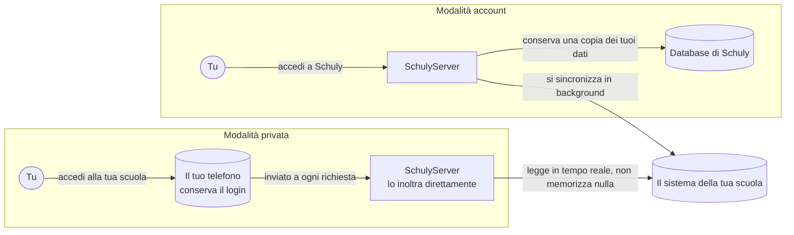

# Modalità dell'app

Usa questa pagina per vedere in cosa differiscono le due modalità dell'app. Scegli una modalità al gate. Entrambe
leggono gli stessi sistemi scolastici dallo stesso catalogo del backend. Differiscono in chi ti fa accedere, dove
viene tenuto il tuo login e se i dati restano su un server. L'app non ha nessun sistema scolastico scritto nel codice.

| | Modalità account | Modalità privata |
| --- | --- | --- |
| Autenticazione verso Schuly | Bearer token dell'account Schuly | Nessuna |
| Client HTTP | `ApiClient` (interceptor di autenticazione) | `Dio` pulito, solo endpoint anonimi |
| Dove risiedono i dati | Lato server, in Postgres | Solo sul dispositivo |
| Ruolo del backend | Memorizza i dati e sincronizza in background | Proxy live senza stato, non memorizza nulla |
| Selezione del provider | Per ogni account collegato | `privateAuthStrategy` del catalogo (`token` o `scrape`) |

## Cosa fa la modalità privata sul dispositivo

- L'app scrive il login della scuola nel keystore del dispositivo. Il login lascia il dispositivo solo quando
  l'app lo invia al sistema scolastico tramite gli endpoint proxy anonimi del backend.
- La schermata di connessione è generica. Mostra i campi di login che il catalogo elenca per la tua scuola e
  segue la `privateAuthStrategy` del catalogo:
  - `token`: un login headless crea un bearer token e una sessione rinnovabile.
  - `scrape`: l'app invia di nuovo le credenziali a ogni recupero dei dati.
- Se la tua scuola usa un codice monouso, l'app ne memorizza il seed insieme al login. La schermata **Authenticator**
  genera i codici sul dispositivo.
- Quando una sessione scade, l'app si riconnette dal keystore senza chiederti di accedere.
