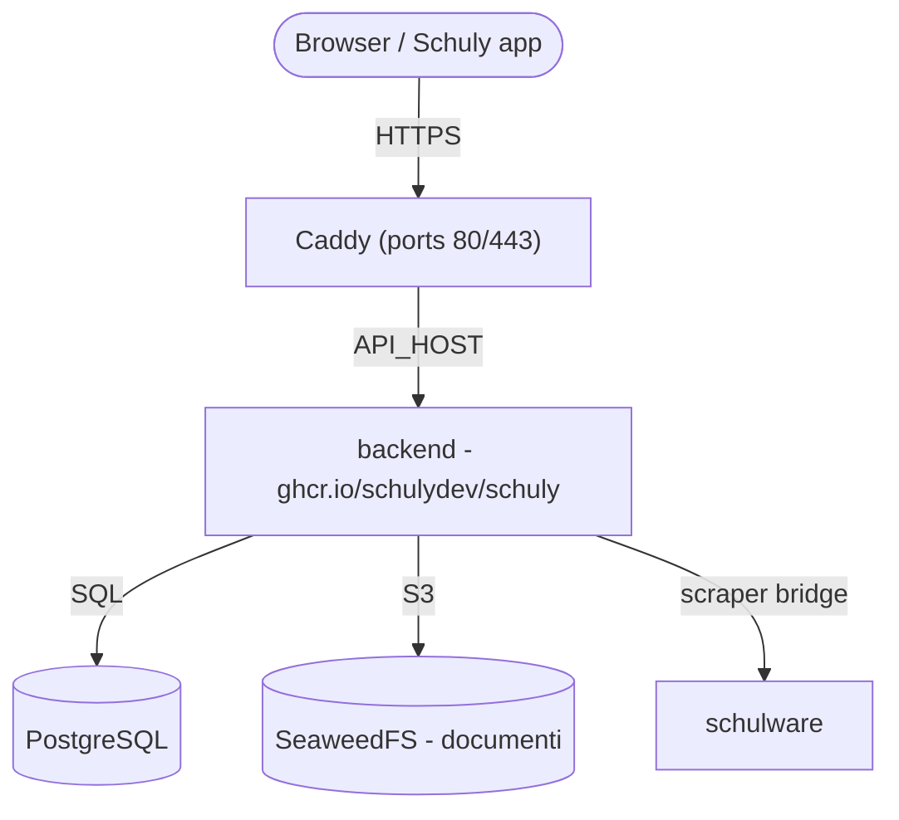

# Self-hosting

Una guida da zero per mettere in piedi il backend Schuly **e i servizi di cui ha
bisogno** sul tuo server, usando le immagini GHCR pubblicate e lo stack già pronto
in [`deploy/`](https://github.com/schulydev/SchulyServer/tree/main/deploy). Tutto
gira dietro [Caddy](https://caddyserver.com/) con HTTPS automatico.

Per lo sviluppo locale vedi invece [Sviluppo](development.md). Per i dettagli su
immagine/release e l'elenco completo delle impostazioni, vedi
[Produzione](production.md) e [Configurazione](configuration.md).

## Cosa eseguirai



| Servizio | Immagine | Esposto |
|---|---|---|
| `caddy` | `caddy:2` | **80 / 443** - le uniche porte pubbliche |
| `backend` | `ghcr.io/schulydev/schuly` | via Caddy → `https://${API_HOST}` |
| `postgres` | `postgres:18.1` | interno (database `schuly`) |
| `seaweedfs` | `chrislusf/seaweedfs` | interno - storage documenti S3 |
| `schulware` | `ghcr.io/pianonic/schulwareapi` | interno - bridge Schulnetz per il plugin Schulware |

L'accesso è integrato nel backend: emette e convalida i propri token e conserva gli
account nel database `schuly`. Non c'è un identity provider separato. Il backend
applica le proprie migrazioni EF Core automaticamente all'avvio e scarica dal
registro i plugin dichiarati in `config/plugins.yml` (nessuna DLL di plugin è
integrata nell'immagine).

## Prerequisiti

- Un server Linux con **Docker** e il **plugin Compose** (`docker compose`).
- Le porte **80** e **443** aperte verso internet.
- Un record DNS che punta al server per l'API (ad es. `api.schuly.example`). Caddy
  ha bisogno che sia risolvibile prima del primo avvio, affinché Let's Encrypt possa
  emettere un certificato.
- Un server SMTP per le mail di verifica e di reimpostazione della password.

## 1. Recupera i file di deploy

Clona il repository (o copia solo la sua cartella `deploy/`) sul server ed entraci:

```sh
git clone https://github.com/schulydev/SchulyServer.git
cd SchulyServer/deploy
```

Tutto ciò che segue viene eseguito da `deploy/`, che si presenta così prima che tu
abbia toccato qualcosa:

```
deploy/
├── .env.example
├── Caddyfile
├── compose.staging.yml
├── config/
│   ├── backend.env
│   ├── plugins.yml
│   ├── plugins-config/
│   │   └── Schuly.Plugin.Schulware.yml
│   └── seaweedfs/
│       └── s3-config.json
└── README.md
```

Alla fine di questa guida avrai anche `.env` (passo 3, a partire da
`.env.example`) e una cartella `data/` (creata automaticamente al primo `up`,
passo 5) che contiene tutto ciò che lo stack conserva:

```
deploy/
├── .env                  # ← lo crei tu
├── ...                   #   (file invariati omessi)
└── data/                 # ← creata al primo `docker compose up`
    ├── postgres/
    ├── seaweedfs/
    ├── plugins/           # DLL dei plugin scaricate
    ├── caddy/              # certificati/stato TLS
    └── caddy-config/
```

## 2. Punta il DNS verso il server

Crea i record A/AAAA per il tuo hostname e attendi che si risolvano verso l'IP
pubblico del server. Finché non lo fanno, l'emissione del certificato fallirà.

## 3. Configura i segreti

Copia il template e compilalo:

```sh
cp .env.example .env
```

| Variabile | Cosa impostare |
|---|---|
| `API_HOST` | Hostname pubblico per l'API, ad es. `api.schuly.example`. |
| `SCHULY_VERSION` | Tag dell'immagine del backend. `latest` segue ogni release; fissa una versione come `1.3.3` per decidere tu stesso quando aggiornare. |
| `POSTGRES_USER` | Utente del database. |
| `POSTGRES_PASSWORD` | Una password del database robusta. |
| `LOCAL_LOGIN_SIGNING_KEY` | Chiave che firma gli access token (obbligatoria). Base64 di 32 byte - generala con `openssl rand -base64 32`. Una nuova chiave disconnette tutti. |
| `TWO_FACTOR_ENCRYPTION_KEY` | Chiave che cifra i segreti della verifica in due passaggi (obbligatoria). Base64 di 32 byte - generala con `openssl rand -base64 32`. Una nuova chiave rompe la verifica in due passaggi per ogni account. |
| `ADMIN_EMAIL` | La tua email. L'account registrato con essa riceve il ruolo `Administrator`. |
| `S3_ACCESS_KEY` | Access key S3 di SeaweedFS. |
| `S3_SECRET_KEY` | Secret key S3 di SeaweedFS. |
| `AVATAR_SIGNING_KEY` | Chiave HMAC per firmare gli URL degli avatar (obbligatoria). Generala con `openssl rand -hex 32`. |
| `DOCUMENTS_ENCRYPTION_KEY` | Chiave master per cifrare a riposo i documenti degli studenti (obbligatoria). Base64 di 32 byte - generala con `openssl rand -base64 32`. Se la perdi, i documenti salvati diventano illeggibili. |
| `SMTP_HOST`, `SMTP_PORT`, `SMTP_FROM`, `SMTP_USER`, `SMTP_PASSWORD` | Server di posta per la verifica dell'email e la reimpostazione della password. |
| `FIREBASE_SERVICE_ACCOUNT_JSON` | Facoltativo. Base64 di un JSON di service account Firebase, per le notifiche push - generalo con `base64 -w0 service-account.json`. Lascialo non impostato per funzionare senza push. |

> Le credenziali S3 **devono corrispondere** a `config/seaweedfs/s3-config.json` -
> aggiorna sia `.env` sia quel file con gli stessi valori, altrimenti lo storage
> dei documenti non si autenticherà.

### Eliminazione dell'account

`DELETE /api/auth/me` cancella tutto ciò che il backend conserva sul chiamante: i suoi
utenti scolastici e tutti i voti, le assenze, le voci dell'agenda, le pagelle
semestrali e i documenti (compresi gli oggetti in S3), poi la riga dell'account
stessa. L'account di accesso (credenziali, token, verifica in due passaggi) viene
eliminato nello stesso passo.

### Conservazione dei dati

Il backend esegue una pulizia di conservazione una volta al giorno, a partire da cinque
minuti dopo l'avvio. Elimina i dati scolastici in cache degli utenti scolastici il cui
`LeaveDate` risale a più di `Retention__MonthsAfterLeave` (6 mesi), ed elimina gli
account che non hanno fatto richieste autenticate per `Retention__MonthsInactive`
(12 mesi). Entrambe le soglie, e l'interruttore `Retention__Enabled`, si trovano in
[`config/backend.env`](https://github.com/schulydev/SchulyServer/blob/main/deploy/config/backend.env).

La pulizia elimina solo i dati di Schuly, non gli account di accesso, quindi chi ha
dati in cache scaduti può accedere di nuovo e risincronizzare.

### Dove vivono le altre impostazioni

`.env` contiene ciò che cambia per ogni deployment. Le impostazioni proprie del
backend si trovano accanto agli altri file di configurazione, e leggono i valori
`${...}` direttamente da `.env`:

| File | Contiene |
|---|---|
| [`config/backend.env`](https://github.com/schulydev/SchulyServer/blob/main/deploy/config/backend.env) | Impostazioni del backend - connessione al database, accesso, SMTP, S3, percorsi dei plugin. |

Normalmente non lo tocchi; esiste affinché `compose.staging.yml` resti leggibile come
rappresentazione dello stack, invece che un muro di variabili d'ambiente.

## 4. (Facoltativo) Rivedi i plugin

`config/plugins.yml` elenca i plugin che il backend carica all'avvio (di default
il plugin Schulware), e `config/plugins-config/` contiene la configurazione di
ciascun plugin. Ogni plugin **fornisce anche una propria voce nel catalogo dei
sistemi scolastici** - il sistema che l'app mostra nel suo selettore (Schulware
contribuisce `schulnetz`, OdaOrg `odaorg`) - quindi installare un plugin aggiunge
automaticamente il suo sistema, senza configurazione del catalogo. I valori
predefiniti funzionano già così come sono; modificali solo se necessario.

## 5. Avvia lo stack

```sh
docker compose -f compose.staging.yml up -d
docker compose -f compose.staging.yml logs -f backend
```

Al primo avvio: Postgres crea il database `schuly`, il backend applica le proprie
migrazioni e popola il catalogo dei sistemi scolastici a partire dai plugin caricati,
e Caddy ottiene un certificato TLS per l'hostname.

## 6. Verifica end-to-end

- `https://${API_HOST}/api/app/school-systems` → l'endpoint anonimo del catalogo,
  a conferma che l'API è attiva (`/api/app` è l'unica rotta non autenticata).
- `https://${API_HOST}/api/app` → la configurazione dell'app (anch'essa anonima);
  il suo campo `version` riporta la versione del backend in esecuzione - utile
  per confermare un deploy o un aggiornamento.
- `https://${API_HOST}/api/plugins` → i plugin caricati (richiede un login
  `Administrator`). Gestiscili a runtime con `POST /api/plugins/install` e
  `DELETE /api/plugins/{name}`.
- Punta l'app Schuly verso `https://${API_HOST}`. L'app accede tramite gli endpoint
  `/auth` del backend.

## 7. Crea il tuo primo login

Apri la web app su `https://${API_HOST}` e registrati con l'indirizzo che hai messo in
`ADMIN_EMAIL`, oppure chiama direttamente `POST https://${API_HOST}/auth/register`.
Conferma l'indirizzo tramite il link nella mail di verifica. Quell'account riceve il
ruolo `Administrator`, necessario per gestire i plugin tramite l'API. Altri
amministratori vanno in `config/backend.env` come `Auth__Administrators__1`,
`Auth__Administrators__2` e così via.

Tutti gli altri si registrano allo stesso modo, dalla web app o dall'app Schuly. Non
ricevono alcun ruolo.

## 8. Blinda per la produzione

- Ruota ogni segreto in `.env` che ha ancora il valore di esempio. Fallo prima che si
  registrino i primi utenti: cambiare `LOCAL_LOGIN_SIGNING_KEY` o
  `TWO_FACTOR_ENCRYPTION_KEY` in seguito disconnette tutti o rompe la verifica in due
  passaggi.
- Mantieni i servizi di gestione/interni non esposti - solo Caddy dovrebbe
  pubblicare porte.

## Esecuzione senza un dominio pubblico (LAN / test locali)

Tutto quanto sopra presuppone un dominio reale con DNS sotto il tuo controllo,
così che Caddy possa ottenere un certificato Let's Encrypt. Se vuoi solo eseguire
lo stack sulla tua rete locale - facendo test verso un telefono via Wi-Fi, senza
dominio, senza TLS - alcune cose cambiano.

L'app (telefono, browser, emulatore) ha bisogno di un indirizzo stabile per il
backend. Due modi per ottenerne uno senza un dominio reale:

- **L'IP LAN della tua macchina, usato direttamente** - `API_HOST=192.168.1.42`,
  senza alcun hostname. Il più semplice, e raggiungibile da un telefono sulla stessa
  Wi-Fi. Svantaggio: si rompe se l'IP cambia (nuovo lease DHCP), ed è raggiungibile
  solo da quella rete.
- **Un hostname DNS jolly (wildcard) puntato sul tuo IP LAN**, ad es. `<ip>.nip.io`
  o `<ip>.sslip.io` - questi si risolvono pubblicamente esattamente verso l'IP
  codificato nel nome. Più elegante di un IP nudo, ma **molti router consumer lo
  bloccano**: la protezione DNS-rebind (attiva di default sulla maggior parte dei
  router FritzBox/AVM, tra gli altri) rifiuta di risolvere un hostname pubblico
  che punta a un indirizzo privato, quindi il nome non si risolverà per nessuno
  su quella rete. Se le risoluzioni falliscono misteriosamente senza un errore
  utile, è quasi sempre questo il motivo - ripiega sull'IP nudo.

Senza un hostname Caddy non può ottenere un certificato, quindi serve invece HTTP
semplice su una porta fissa.

### Esempio pratico

Supponi che l'IP LAN della tua macchina sia `192.168.1.42`. Nulla della struttura
della cartella `deploy/` dal passo 1 cambia - stai modificando tre dei file
esistenti sul posto, niente di più:

```
deploy/
├── .env                  ← crealo da .env.example; API_HOST = l'IP LAN
├── Caddyfile              ← modifica: HTTP semplice, porta esplicita
├── compose.staging.yml    ← modifica: porte del servizio caddy
├── config/
│   ├── backend.env        ← modifica: link http nelle mail
│   ├── plugins.yml         (invariato)
│   ├── plugins-config/
│   │   └── Schuly.Plugin.Schulware.yml   (invariato)
│   └── seaweedfs/
│       └── s3-config.json                (invariato)
└── data/                  (creata al primo `up`, come nel caso del dominio)
```

**`.env`** - stesso template del passo 3, punta semplicemente l'hostname verso l'IP
nudo:

```sh
API_HOST=192.168.1.42
SCHULY_VERSION=latest
POSTGRES_USER=schuly
POSTGRES_PASSWORD=change-me-postgres
LOCAL_LOGIN_SIGNING_KEY=<openssl rand -base64 32>
TWO_FACTOR_ENCRYPTION_KEY=<openssl rand -base64 32>
ADMIN_EMAIL=you@example.com
S3_ACCESS_KEY=schuly-access
S3_SECRET_KEY=change-me-s3-secret
AVATAR_SIGNING_KEY=change-me-avatar-signing-key
DOCUMENTS_ENCRYPTION_KEY=change-me-documents-encryption-key
```

Mantieni i valori `SMTP_*`, oppure puntali verso un catcher SMTP nella tua rete, così
le mail di verifica arrivano da qualche parte.

**`Caddyfile`** - sostituisci l'intero file (la versione basata su dominio ottiene un
certificato TLS; questa fa solo da proxy HTTP semplice su una porta):

```
http://{$API_HOST}:8080 {
	reverse_proxy backend:8080
}
```

**`compose.staging.yml`** - nel servizio `caddy`, sostituisci l'elenco `ports:`
(rimuovi `443:443`, non c'è alcun certificato da servire):

```yaml
  caddy:
    image: caddy:2
    restart: unless-stopped
    ports:
      - "8080:8080"
    environment:
      API_HOST: ${API_HOST}
    volumes:
      - ./Caddyfile:/etc/caddy/Caddyfile:ro
      - ./data/caddy:/data
      - ./data/caddy-config:/config
    depends_on:
      - backend
```

**`config/backend.env`** - i link nelle mail devono puntare all'indirizzo HTTP
semplice:

```
Email__Smtp__PasswordResetLinkTemplate=http://${API_HOST}:8080/reset-password?token={token}
Email__Smtp__EmailVerificationLinkTemplate=http://${API_HOST}:8080/verify-email?token={token}
```

Poi avvia tutto esattamente come nel passo 5:

```sh
docker compose -f compose.staging.yml up -d
docker compose -f compose.staging.yml logs -f backend
```

E verifica con gli stessi controlli del passo 6, semplicemente con `http://` e
una porta invece di `https://`:

```sh
curl http://192.168.1.42:8080/api/app/school-systems       # catalogo anonimo
```

Tutto il resto - i passi indipendenti dal DNS come il caricamento dei plugin e la
procedura del primo login descritta sopra - funziona esattamente allo stesso modo.
Un'ultima cosa utile da sapere: il Windows Firewall potrebbe bloccare silenziosamente
un telefono sulla stessa Wi-Fi dal raggiungere queste porte la prima volta - consenti
Docker Desktop sulla rete **Privata** se richiesto, oppure aggiungi tu stesso una
regola in ingresso per le porte.

## Operazioni

- **Persistenza** - tutto lo stato è **montato tramite bind mount su cartelle
  dell'host sotto `./data`** (nessun volume nominato): `data/postgres`,
  `data/seaweedfs`, `data/plugins`, `data/caddy*`. Questa è la configurazione
  consigliata - i tuoi dati restano visibili e facili da salvare sull'host. Le
  cartelle vengono create al primo `up`, e un servizio one-shot `init-perms`
  rende `data/plugins` scrivibile automaticamente dall'utente del backend, così
  funziona semplicemente al primo avvio. Per azzerare tutto, ferma lo stack ed
  elimina `./data`.
- **Aggiornamenti** - imposta `SCHULY_VERSION` in `.env` su una versione fissa invece
  di `latest`, così un deploy si ripete esattamente identico e sei tu a scegliere
  quando avanzare. Cambia la versione, poi `up -d` per procedere. Le migrazioni girano
  automaticamente sul nuovo container; esegui un backup di `data/postgres` prima di
  salti di versione importanti.
- **Abbandonare Keycloak** - i deployment più vecchi eseguivano un container Keycloak
  separato. Le password non possono essere trasferite da Keycloak, quindi gli utenti
  esistenti si registrano di nuovo (o reimpostano la password). Aggiungi le nuove
  impostazioni di accesso a `.env` (passo 3), rimuovi le variabili `AUTH_HOST`,
  `KEYCLOAK_VERSION` e `KC_*`, e prendi dal repository i nuovi file
  `compose.staging.yml`, `Caddyfile` e `config/`.
- **Modifiche ai plugin** effettuate tramite l'API vengono salvate in
  `config/plugins.yml`.

## Riferimento: il `compose.staging.yml` completo

Per comodità, lo stack completo eseguito da questa guida (lo stesso file vive
nella cartella `deploy/` del repository). Tutto lo stato è montato tramite bind
mount sotto `./data` - nessun volume nominato - e un servizio one-shot
`init-perms` rende la cartella dei plugin scrivibile dal backend al primo
avvio, così un semplice `docker compose up` funziona.

```yaml
services:
  # One-shot: rende la cartella dei plugin montata tramite bind mount scrivibile
  # dall'utente non-root del backend (uid 1654) prima che questo si avvii, così
  # un semplice `up` funziona già al primissimo avvio senza chown manuale.
  # Viene eseguito una sola volta e termina.
  init-perms:
    image: busybox:1.37
    command: sh -c "mkdir -p /data/plugins && chown -R 1654:1654 /data/plugins"
    volumes:
      - ./data:/data
    restart: "no"

  postgres:
    image: postgres:18.1
    restart: unless-stopped
    environment:
      POSTGRES_USER: ${POSTGRES_USER}
      POSTGRES_PASSWORD: ${POSTGRES_PASSWORD}
      POSTGRES_DB: schuly
    volumes:
      # postgres:18 conserva i dati in una sottocartella con versione, quindi
      # il mount avviene su /var/lib/postgresql (non /var/lib/postgresql/data,
      # che ora viene rifiutato).
      - ./data/postgres:/var/lib/postgresql
    healthcheck:
      # -h 127.0.0.1 forza un controllo TCP. Mentre l'entrypoint esegue gli
      # script di init serve solo sul socket Unix, quindi un controllo basato
      # su socket segnalerebbe "healthy" a metà inizializzazione, lasciando che
      # i servizi dipendenti si colleghino a un server che sta per riavviarsi.
      test: ["CMD-SHELL", "pg_isready -U ${POSTGRES_USER} -d schuly -h 127.0.0.1"]
      interval: 10s
      timeout: 5s
      retries: 10

  seaweedfs:
    image: chrislusf/seaweedfs:latest
    restart: unless-stopped
    command: >
      server -dir=/data
      -s3 -s3.config=/etc/seaweedfs/s3-config.json -s3.port=8333
      -master.volumeSizeLimitMB=1024
    volumes:
      - ./data/seaweedfs:/data
      - ./config/seaweedfs/s3-config.json:/etc/seaweedfs/s3-config.json:ro

  schulware:
    image: ghcr.io/pianonic/schulwareapi:latest
    restart: unless-stopped
    environment:
      # Il client id Schulnetz e l'host PWA sono già integrati come predefiniti
      # nell'immagine SchulwareAPI, quindi qui non serve alcuna configurazione
      # Schulnetz.
      PYTHONUNBUFFERED: "1"

  backend:
    image: ghcr.io/schulydev/schuly:${SCHULY_VERSION:-latest}
    restart: unless-stopped
    env_file: [./config/backend.env]
    volumes:
      - ./data/plugins:/app/plugins                        # DLL dei plugin scaricate (cartella host)
      - ./config/plugins.yml:/app/plugins.yml              # set di plugin desiderato (scrivibile: gli endpoint lo riscrivono)
      - ./config/plugins-config:/app/plugins-config:ro     # configurazione per-plugin
    depends_on:
      postgres:
        condition: service_healthy
      init-perms:
        condition: service_completed_successfully

  caddy:
    image: caddy:2
    restart: unless-stopped
    ports:
      - "80:80"
      - "443:443"
    environment:
      API_HOST: ${API_HOST}
    volumes:
      - ./Caddyfile:/etc/caddy/Caddyfile:ro
      - ./data/caddy:/data
      - ./data/caddy-config:/config
    depends_on:
      - backend
```
