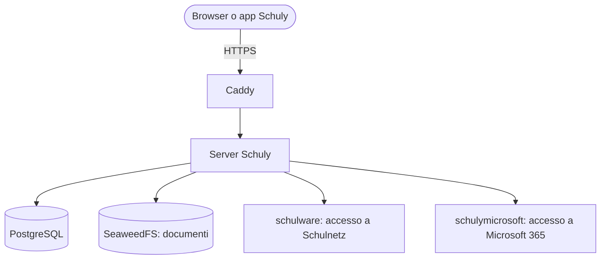

# Self-hosting di Schuly

Esegui il tuo server Schuly con Docker. Alla fine, l'app Schuly e l'app web usano il tuo server
con HTTPS automatico.

Fai una prova sulla tua rete domestica, senza un dominio? Usa [Eseguire senza dominio](self-hosting-lan.md).

## Cosa ti serve

- Un server Linux con Docker e il plugin Docker Compose
- Le porte 80 e 443 aperte verso internet
- Un nome di dominio per il server, come `api.schuly.example`
- Un server SMTP, così Schuly può inviare le mail di verifica e di reimpostazione della password

## Cosa gira sul tuo server



Solo Caddy è raggiungibile da internet. Schuly ha il proprio accesso, quindi non ti serve un
identity provider separato.

## 1. Punta il dominio verso il server

Crea un record A o AAAA per il tuo dominio e attendi che punti al tuo server. Caddy
non può ottenere un certificato prima di allora.

## 2. Recupera i file di deploy

```sh
curl -fsSL https://github.com/schulydev/SchulyServer/archive/refs/heads/main.tar.gz | tar -xz --strip-components=1 SchulyServer-main/deploy
cd deploy
cp .env.example .env
```

Esegui tutti i comandi di questa pagina dalla cartella `deploy`.

## 3. Compila `.env`

Sostituisci ogni valore `change-me` prima del primo avvio.

| Variabile | Valore |
|---|---|
| `API_HOST` | Il tuo dominio, come `api.schuly.example` |
| `SCHULY_VERSION` | Una versione fissa delle [release](https://github.com/schulydev/SchulyServer/releases), così decidi tu quando aggiornare. `latest` segue ogni release. |
| `POSTGRES_USER`, `POSTGRES_PASSWORD` | Un utente del database e una password robusta |
| `LOCAL_LOGIN_SIGNING_KEY` | Output di `openssl rand -base64 32` |
| `TWO_FACTOR_ENCRYPTION_KEY` | Output di `openssl rand -base64 32` |
| `DOCUMENTS_ENCRYPTION_KEY` | Output di `openssl rand -base64 32` |
| `VAULT_MASTER_KEY` | Output di `openssl rand -base64 32` |
| `AVATAR_SIGNING_KEY` | Output di `openssl rand -hex 32` |
| `S3_ACCESS_KEY`, `S3_SECRET_KEY` | Una chiave di accesso e un segreto robusto |
| `SMTP_HOST`, `SMTP_PORT`, `SMTP_FROM`, `SMTP_USER`, `SMTP_PASSWORD` | Il tuo server di posta |

Poi imposta gli stessi valori S3 in `config/seaweedfs/s3-config.json`. Se sono diversi, lo storage dei
documenti non funziona.

::: warning Fai il backup di `.env` e conserva le chiavi
Cambiare una chiave in seguito ha effetti duraturi:

- `LOCAL_LOGIN_SIGNING_KEY`: tutti vengono disconnessi.
- `TWO_FACTOR_ENCRYPTION_KEY`: l'autenticazione a due fattori smette di funzionare per ogni account.
- `DOCUMENTS_ENCRYPTION_KEY`: i documenti memorizzati diventano illeggibili.
- `VAULT_MASTER_KEY`: tutti devono ricollegare la propria scuola.
:::

## 4. Avvia Schuly

```sh
docker compose -f compose.staging.yml up -d
docker compose -f compose.staging.yml logs -f backend
```

Al primo avvio, Schuly prepara il suo database e scarica i suoi plugin, e Caddy ottiene un
certificato.

## 5. Verifica che funzioni

Apri `https://<your domain>/api/app/school-systems`. Dovresti vedere un elenco di sistemi scolastici.

## 6. Crea il tuo account

Apri `https://<your domain>` e registrati. Tutti gli account sono uguali e vedono solo i propri dati.
Non esiste un ruolo di amministratore.

## 7. Collega l'app

Nell'app Schuly, scegli **Self-hosted** nella schermata del server e inserisci
`https://<your domain>` come **Backend URL**.

## Funzioni facoltative

| Funzione | Come attivarla |
|---|---|
| Notifiche push | Imposta `FIREBASE_SERVICE_ACCOUNT_JSON` in `.env`. Vedi [Configurazione](configuration.md#push-notifications-firebase). |
| Accesso con password Microsoft nell'app web | Imposta `MICROSOFT_SERVICE_KEY` in `.env` sull'output di `openssl rand -hex 32`. |
| Single sign-on | Vedi [Configurazione](configuration.md#single-sign-on-oidc-providers). |
| Helply, l'assistente IA | Aggiungi `Helply__BaseUrl` e `Helply__ApiKey` a `config/backend.env`. Vedi [Configurazione](configuration.md#helply). |
| Il workspace di codice di Helply | Vedi il [README di deploy](https://github.com/schulydev/SchulyServer/blob/main/deploy/README.md). |

Per scegliere quali sistemi scolastici offre il tuo server, vedi [Gestione dei plugin](../plugin-management.md).

## Prossimi passi

- [Gestire e aggiornare il server](operations.md)
- [Tutte le impostazioni](configuration.md)
